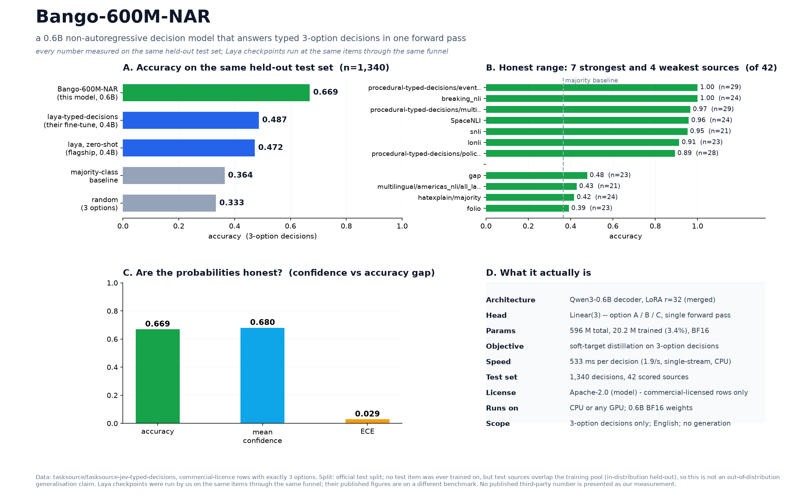

# Bango-600M-NAR

**Non-autoregressive System 1 decision model.** Give it a **state** and a question with exactly **three options**; it returns the chosen option with a calibrated probability in a single forward pass. It never generates text, so there is nothing to parse and nothing to hallucinate.

0.6B parameters · 3-option decisions · English · Apache-2.0 · ECE **0.029** on 1,340 held-out decisions.

<p align="center">
  
</p>

## Installation

```bash
pip install torch transformers
```

Python 3.10 or newer, and a CPU is enough.

## Quickstart

```python
import torch
from transformers import AutoModelForSequenceClassification, AutoTokenizer

REPO = "doggydon007/bango-600m-nar"
tok = AutoTokenizer.from_pretrained(REPO, trust_remote_code=True)
model = AutoModelForSequenceClassification.from_pretrained(
    REPO, trust_remote_code=True).eval()

def decide(state, question, options):
    assert len(options) == 3, "this model handles exactly 3 options"
    text = (f"State: {state}\nQuestion: {question}\nOptions:\n"
            f"(A) {options[0]}\n(B) {options[1]}\n(C) {options[2]}\nAnswer:")
    ids = tok(text, return_tensors="pt", add_special_tokens=False)
    with torch.no_grad():
        probs = model(**ids).logits.float().softmax(-1)[0]
    k = int(probs.argmax())
    return "ABC"[k], float(probs[k]), [round(float(p), 3) for p in probs]

print(decide(
    state="Account flagged for a single failed payment, first offence.",
    question="Do we grant a 7-day grace period?",
    options=["Yes, grant it", "No, suspend now", "Escalate to a human"],
))
```

You get back the chosen option, its probability, and the full distribution over the three options. Route low-confidence decisions to a human instead of trusting the argmax.

### Input format

```
State: <free text describing the situation>
Question: <the decision you must make>
Options:
(A) <first option>
(B) <second option>
(C) <third option>
Answer:
```

Exactly **three** options. Long states are truncated from the *state* side so the three options always survive (512-token budget).

## What's in this repo

| | |
|---|---|
| `model.safetensors` | the merged 0.6B checkpoint (BF16) |
| `config.json`, `tokenizer*` | standard `transformers` model config and tokenizer |
| `assets/bango_benchmark.png` | the benchmark figure shown above |
| `eval/bango_results.json` | this model's measured results on the held-out decisions |
| `eval/bango_vs_laya_results.json` | the Laya checkpoints run by us on the same decisions |

The scripts that build this card, the benchmark tables and the figure live in the [GitHub repo](https://github.com/doggydon007/bango-600m-nar), together with the raw `results/*.json` files they read from.

## Architecture

- **Backbone:** Qwen3-0.6B decoder. The language-model head is replaced by a 3-way linear classifier over the last-token hidden state, so a decision is one forward pass and the output is always exactly three numbers.
- **Adaptation:** LoRA (r=32, alpha=64) on the attention and MLP projections, trained over a frozen backbone, then **merged** into a single monolithic checkpoint. Inference needs no PEFT and no adapter loading.
- **Parameters:** 596M total, of which 20.2M (3.4%) were trained.
- **Budget:** 512 tokens per decision. The option block is protected; only the state is truncated.
- **Output:** `logits` of shape `(1, 3)`. There is no text generation, so there is no format to parse.

## Training

**Soft-target distillation.** Each training decision carries a full probability distribution over its three options, and the model is trained to match that distribution rather than a hard argmax. That teaches it to distinguish a clear decision from a genuinely ambiguous one, which is what makes the confidence number usable downstream.

**Data.** 3-option decisions drawn from [`tasksource/tasksource-jev-typed-decisions`](https://huggingface.co/datasets/tasksource/tasksource-jev-typed-decisions), restricted to rows licensed for commercial use.

**Scale.** The decision head and adapters released here were trained on 58,368 three-option decisions (**12.4M tokens**). They sit on a frozen backbone trained earlier on 292,780 examples (**36.3M tokens** over 2 passes). Total training behind this artifact: about **49M tokens** across 351,148 examples.

## Benchmarks

Measured on 1,340 held-out 3-option decisions that were never trained on. The Laya checkpoints were run by us on the **same items** through the **same** A/B/C funnel, so the comparison is like-for-like.

### Accuracy

| Model | Params | Accuracy | Macro-F1 |
|---|---|---|---|
| **Bango-600M-NAR** | 0.6B | **0.669** | **0.667** |
| laya-typed-decisions | 0.4B | 0.487 | 0.485 |
| laya (zero-shot) | 0.4B | 0.472 | 0.472 |
| Majority-class baseline | - | 0.364 | - |
| Random (3 options) | - | 0.333 | - |

Across the 42 decision sources both models were scored on, Bango-600M-NAR wins on **33 of 42** (79%). Grouped accuracy over those shared sources: **0.686** against Laya's **0.499**.

### Speed

533 ms per decision, single-stream, (1.9 decisions/sec) on 8 vCPU (torch float32).

### Calibration

| Metric | Value |
|---|---|
| Accuracy | 0.669 |
| Mean confidence | 0.680 |
| Expected calibration error | **0.029** |

When this model says it is 0.8 sure, it is right about 80% of the time, so the confidence can be used as a routing signal.

### Per-source accuracy

All 42 decision sources with at least 15 test items. Strong and weak sources are both listed.

| Source | n | Bango-600M-NAR | laya-typed-decisions | Δ |
|---|---|---|---|---|
| `WANLI` | 69 | 0.739 | 0.652 | +0.087 |
| `FOL-nli` | 62 | 0.645 | 0.371 | +0.274 |
| `knowref60k` | 56 | 0.661 | 0.554 | +0.107 |
| `social_i_qa` | 51 | 0.647 | 0.451 | +0.196 |
| `procedural-typed-decisions/policy_applicability` | 37 | 0.595 | 0.270 | +0.324 |
| `spartqa-yn` | 35 | 0.657 | 0.486 | +0.171 |
| `corr2cause` | 35 | 0.657 | 0.257 | +0.400 |
| `procedural-typed-decisions/record_eligibility` | 30 | 0.700 | 0.400 | +0.300 |
| `procedural-typed-decisions/event_state_reconstruction` | 29 | 1.000 | 0.759 | +0.241 |
| `procedural-typed-decisions/multi_view_adjudication` | 29 | 0.966 | 0.379 | +0.586 |
| `procedural-typed-decisions/state_perturbation` | 28 | 0.500 | 0.500 | +0.000 |
| `procedural-typed-decisions/policy_under_uncertainty` | 28 | 0.893 | 0.536 | +0.357 |
| `hatexplain/majority` | 24 | 0.417 | 0.417 | +0.000 |
| `multilingual/multilingual-sentiments/all` | 24 | 0.625 | 0.458 | +0.167 |
| `twitter-financial-news-sentiment` | 24 | 0.833 | 0.667 | +0.167 |
| `breaking_nli` | 24 | 1.000 | 0.875 | +0.125 |
| `SpaceNLI` | 24 | 0.958 | 0.458 | +0.500 |
| `newsmtsc` | 24 | 0.583 | 0.667 | -0.083 |
| `wands` | 24 | 0.542 | 0.250 | +0.292 |
| `CONDAQA` | 24 | 0.500 | 0.417 | +0.083 |
| `headline_cause/en_simple` | 24 | 0.708 | 0.083 | +0.625 |
| `vitaminc` | 23 | 0.826 | 0.609 | +0.217 |
| `gap` | 23 | 0.478 | 0.522 | -0.043 |
| `lonli` | 23 | 0.913 | 0.565 | +0.348 |
| `wice` | 23 | 0.696 | 0.696 | +0.000 |
| `scientific-exaggeration-detection` | 23 | 0.609 | 0.522 | +0.087 |
| `tab/identifier` | 23 | 0.522 | 0.391 | +0.130 |
| `folio` | 23 | 0.391 | 0.478 | -0.087 |
| `naturallogic` | 22 | 0.818 | 0.500 | +0.318 |
| `multilingual/tweet_sentiment_multilingual` | 21 | 0.524 | 0.476 | +0.048 |
| `snli` | 21 | 0.952 | 0.857 | +0.095 |
| `multilingual/americas_nli/all_languages` | 21 | 0.429 | 0.476 | -0.048 |
| `sentfin` | 21 | 0.762 | 0.667 | +0.095 |
| `hope_edi/english` | 21 | 0.809 | 0.476 | +0.333 |
| `redial/preference` | 21 | 0.714 | 0.809 | -0.095 |
| `equate` | 21 | 0.524 | 0.381 | +0.143 |
| `propsegment/nli` | 21 | 0.857 | 0.619 | +0.238 |
| `mams/atsa` | 20 | 0.550 | 0.450 | +0.100 |
| `shell-safety-v2` | 20 | 0.650 | 0.250 | +0.400 |
| `syntactic-augmentation-nli` | 20 | 0.500 | 0.500 | +0.000 |
| `temporal-nli` | 18 | 0.667 | 0.500 | +0.167 |
| `nan-nli` | 15 | 0.733 | 0.467 | +0.267 |

## Honest Limits

- **In-distribution benchmark.** The evaluation items were never trained on, but they are drawn from the same source pool as the training decisions. This measures held-out performance on a matching distribution, not out-of-distribution generalisation. A new, unrelated decision domain will score lower.
- **Three options only.** Two-option and five-option questions are out of scope, and there is no separate yes/no head.
- **English only.**
- **No chain-of-thought.** The decision is a single forward pass by design. On questions that need multi-step reasoning, a larger generative model that can think will beat it.
- **High-entropy sources stay hard.** Some sources sit near the majority-class baseline; the model is only as good as the label distribution it was taught.
- **Label quality is inherited.** Soft targets come from the upstream dataset; where those are noisy, the model learns the noise.
- **Not a safety layer.** Do not put this as the only gate on irreversible actions. Gate on confidence and escalate.

## Published numbers from other projects

These come from other authors, on **different test sets**, and were **not** measured here. They are included for context and are not comparable to the tables above.

| Source | Published | Test set / protocol |
|---|---|---|
| laya-typed-decisions | 0.766 | `LocalLLaMA/typed-decisions`, its own 4-option workflow benchmark, fine-tuned on that benchmark's train split |
| Jev 1.13.0 | 0.727 | same `LocalLLaMA/typed-decisions` benchmark |

For contrast, when those same Laya checkpoints are run by us on the 3-option task used throughout this card, they score 0.472 (zero-shot) and 0.487 (their fine-tune).

## Links

- **GitHub:** https://github.com/doggydon007/bango-600m-nar
- **Weights:** https://huggingface.co/doggydon007/bango-600m-nar

Apache 2.0.

